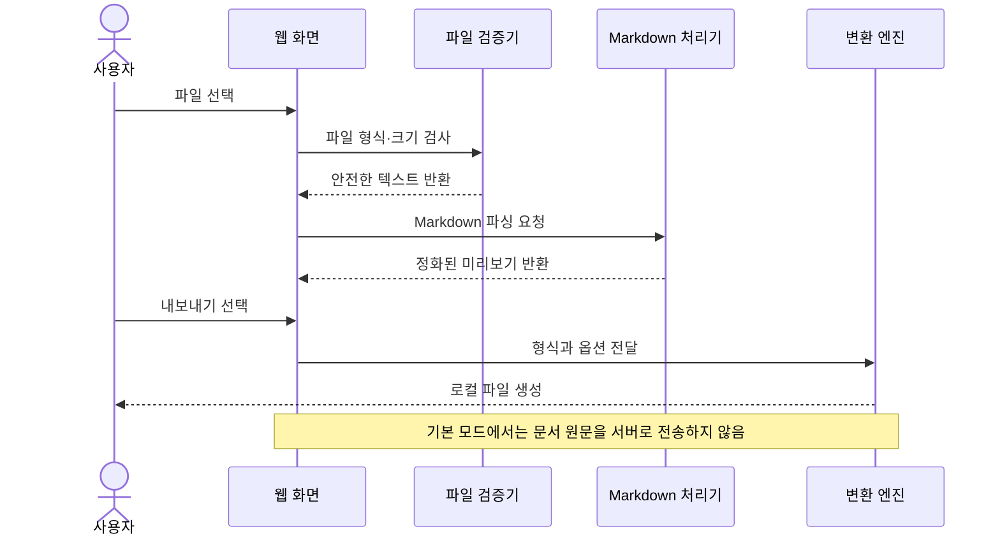

# PRD: GUI 기반 Markdown 문서 리더·변환 웹앱

> 문서 상태: 기획 초안 v0.1  
> 작성일: 2026-07-16  
> 승인 상태: 승인 완료 (2026-07-16)  
> 개발 착수 조건: May 작가님 승인 후 시작

## 1. 제품 개요

### 1.1 한 줄 정의

Markdown 파일을 화면에 끌어다 놓으면 원문과 완성된 문서 화면을 함께 확인하고, PDF·HTML·DOCX로 변환할 수 있는 비개발자용 웹앱이다.

### 1.2 가칭

| 구분 | 제안 이름 | 의미 |
|---|---|---|
| 추천 | **MD Canvas** | Markdown 문서를 시각적으로 펼쳐 보는 작업 공간 |
| 대안 1 | **마크뷰(MarkView)** | 읽기 기능이 바로 이해되는 이름 |
| 대안 2 | **문서브릿지(DocBridge)** | Markdown과 일반 문서 형식을 연결 |

### 1.3 기획 배경

Markdown은 AI 도구, Obsidian, GitHub, 문서 자동화에서 널리 사용되지만 비개발자는 다음 문제를 겪는다.

1. `.md` 파일을 어떤 프로그램으로 열어야 하는지 모른다.
2. 기호가 포함된 원문보다 일반 문서처럼 정리된 화면을 원한다.
3. PDF나 Word 문서로 바꾸는 과정이 복잡하다.
4. 변환 사이트에 민감한 문서를 업로드하는 것을 불안해한다.
5. 한글 글꼴, 표, 이미지, 줄바꿈이 변환 결과에서 깨진다.

## 2. 목표와 성공 기준

### 2.1 제품 목표

- 설치 없이 브라우저에서 Markdown 문서를 연다.
- 원문과 렌더링 결과를 동시에 보여준다.
- 클릭 3회 이내에 PDF·HTML·DOCX로 변환한다.
- 기본 모드에서는 문서를 서버에 저장하지 않는다.
- 40~60대 비전문가도 설명서 없이 핵심 기능을 사용한다.

### 2.2 성공 지표

| 지표 | MVP 목표 |
|---|---:|
| 첫 파일 열기 완료율 | 90% 이상 |
| 파일 선택 후 미리보기 표시 시간 | 2초 이내(5MB 이하 기준) |
| 변환 완료율 | 95% 이상 |
| 파일 열기부터 변환까지 | 3분 이내 |
| 핵심 작업 클릭 수 | 3회 이내 |
| 서버로 전송되는 문서 원문 | 기본 모드 0건 |

## 3. 핵심 사용자

### 3.1 주요 사용자

| 사용자 | 상황 | 핵심 요구 |
|---|---|---|
| 강사·교육자 | AI가 만든 Markdown 강의안을 배포 | PDF·Word 변환, 읽기 좋은 서식 |
| 40~60대 비전문가 | 전달받은 `.md` 파일 확인 | 쉬운 열기, 큰 글씨, 명확한 버튼 |
| 콘텐츠 실무자 | 블로그·보고서 초안 재사용 | HTML 복사, 문서 변환 |
| Obsidian 사용자 | 노트를 외부에 공유 | 링크·이미지·표를 유지한 내보내기 |
| 개발자·기획자 | README·기획서 검토 | 원문/미리보기 비교, 코드 블록 유지 |

### 3.2 대표 사용자 이야기

> 강사인 사용자는 AI가 작성한 `.md` 강의안을 웹앱에 끌어다 놓고, 오른쪽 미리보기에서 표와 제목을 확인한 뒤 PDF로 저장해 수강생에게 공유한다.

## 4. MVP 범위

### 4.1 반드시 포함

1. 드래그 앤 드롭 및 파일 선택으로 `.md`, `.markdown`, `.txt` 열기
2. UTF-8 한글 문서 읽기
3. 원문/미리보기 분할 화면
4. 읽기 전용 모드와 간단 편집 모드
5. 제목, 목록, 표, 링크, 이미지, 인용문, 코드 블록 렌더링
6. PDF, HTML, DOCX 내보내기
7. 라이트/다크 테마
8. 글자 크기 조절
9. 최근 작업은 브라우저 안에만 임시 저장
10. 파일 크기·형식 오류 안내

### 4.2 다음 버전으로 연기

- 여러 파일 일괄 변환
- 폴더 및 ZIP 가져오기
- Obsidian 내부 링크와 그래프 보기
- 사용자 템플릿 제작기
- 클라우드 동기화
- AI 요약·번역·교정
- 실시간 공동 편집
- 모바일 앱 및 데스크톱 앱

### 4.3 제외 범위

- Google Docs·Microsoft Word와 완벽히 동일한 편집 기능
- 복잡한 출판용 조판
- 서버에 문서를 영구 보관하는 문서 관리 시스템
- 모든 Markdown 확장 문법의 100% 호환

## 5. 핵심 사용자 흐름


## 6. 화면 구성

### 6.1 화면 목록

| 화면 | 주요 요소 | 목적 |
|---|---|---|
| 시작 화면 | 드롭존, 파일 선택, 샘플 열기 | 첫 행동을 명확하게 안내 |
| 문서 작업 화면 | 파일명, 원문, 미리보기, 보기 전환 | 문서 확인·수정 |
| 내보내기 패널 | 형식, 용지, 테마, 파일명 | 변환 옵션 설정 |
| 완료 화면 | 결과 파일, 다시 변환, 새 문서 | 작업 완료 확인 |
| 도움말 | 지원 문법, 개인정보 처리, 오류 해결 | 비개발자 자가 해결 |

### 6.2 데스크톱 기본 레이아웃

```text
┌────────────────────────────────────────────────────────────┐
│ MD Canvas  파일 열기  샘플  테마  도움말                  │
├───────────────────────────┬────────────────────────────────┤
│ 원문                      │ 미리보기                       │
│ # 강의 제목               │ 강의 제목                      │
│ - 학습 목표               │ • 학습 목표                    │
│                           │                                │
├───────────────────────────┴────────────────────────────────┤
│ 글자 크기  보기 전환                  PDF HTML DOCX 내보내기 │
└────────────────────────────────────────────────────────────┘
```

### 6.3 UX 원칙

- 핵심 버튼은 한국어 동사로 표시한다: `파일 열기`, `미리보기`, `PDF로 저장`.
- 아이콘만 있는 버튼에는 항상 텍스트 또는 툴팁을 제공한다.
- 기본 글자 크기는 16px 이상, 주요 버튼 높이는 44px 이상으로 한다.
- 오류 메시지는 원인, 현재 상태, 해결 행동을 함께 보여준다.
- 작업 전환 시 사용자가 작성한 내용을 먼저 보호한다.

## 7. 기능 요구사항

| ID | 기능 | 요구사항 | 우선순위 |
|---|---|---|---|
| FR-01 | 파일 가져오기 | 드래그 앤 드롭과 파일 선택 지원 | P0 |
| FR-02 | 파일 검증 | 확장자, MIME 유형, 크기, 인코딩 검사 | P0 |
| FR-03 | Markdown 렌더링 | GFM 표·체크리스트·코드 블록 포함 | P0 |
| FR-04 | 화면 모드 | 분할, 원문 전용, 미리보기 전용 | P0 |
| FR-05 | 간단 편집 | 원문 수정 시 미리보기 자동 갱신 | P0 |
| FR-06 | PDF 변환 | A4, 여백, 테마, 페이지 번호 설정 | P0 |
| FR-07 | HTML 변환 | 독립 실행 가능한 HTML 파일 생성 | P0 |
| FR-08 | DOCX 변환 | 제목·목록·표·기본 이미지 유지 | P0 |
| FR-09 | 접근성 | 키보드 탐색, 명확한 포커스, 대비 준수 | P1 |
| FR-10 | 임시 복구 | 새로고침 후 최근 작업 복구 여부 선택 | P1 |
| FR-11 | 인쇄 | 브라우저 인쇄용 레이아웃 제공 | P1 |
| FR-12 | 샘플 문서 | 기능 체험용 한글 예제 제공 | P1 |

## 8. 비기능 요구사항

### 8.1 성능

- 5MB 이하 문서는 일반 데스크톱 환경에서 2초 이내에 미리보기를 표시한다.
- 입력 후 미리보기 갱신은 300ms 이내를 목표로 한다.
- 10MB를 초과한 파일은 경고하고 최대 20MB까지만 허용한다.

### 8.2 호환성

- 최신 Chrome, Edge, Safari에서 핵심 기능을 지원한다.
- 데스크톱을 우선하고 태블릿은 미리보기 전용 흐름까지 지원한다.
- 모바일에서는 읽기와 HTML/PDF 저장을 우선 지원한다.

### 8.3 접근성

- WCAG 2.2 AA 수준을 목표로 한다.
- 모든 핵심 기능은 키보드로 실행할 수 있어야 한다.
- 색상만으로 상태를 전달하지 않는다.

## 9. 개인정보·권한·보안

### 9.1 기본 보안 원칙

1. 문서 파싱과 변환은 가능한 범위에서 브라우저 내부에서 처리한다.
2. 서버 저장 기능은 MVP에서 제공하지 않는다.
3. 외부 이미지 URL은 사용자 동의 없이 자동 전송하거나 추적하지 않는다.
4. Markdown 내부 HTML은 기본적으로 비활성화하거나 정화한다.
5. 스크립트, 이벤트 핸들러, 위험한 URL 스킴을 제거해 XSS를 차단한다.
6. 로컬 임시 데이터 삭제 버튼을 제공한다.
7. 배포 전 KESE-KIT 기준의 보안 점검과 의존성 취약점 검사를 수행한다.

### 9.2 권한 계획

MVP는 로그인 없는 로컬 처리형이므로 역할 기반 권한 제어(RBAC)가 필요하지 않다. 향후 클라우드 저장·팀 공유 기능을 추가할 때 다음 역할을 적용한다.

| 역할 | 권한 |
|---|---|
| 사용자 | 본인 문서 열기·편집·변환·삭제 |
| 팀 편집자 | 공유 문서 열기·편집·변환 |
| 팀 열람자 | 공유 문서 읽기·변환 |
| 관리자 | 사용자·팀·정책 관리, 감사 로그 열람 |

### 9.3 배포 전 보안 체크리스트

- Markdown HTML 정화 및 XSS 테스트
- 악성 링크와 `javascript:` URL 차단
- SVG·외부 이미지 처리 정책 검증
- 파일 확장자와 실제 콘텐츠 유형 교차 검사
- 대용량·비정상 입력에 대한 서비스 거부 방어
- `npm audit` 등 의존성 취약점 검사
- 보안 헤더(CSP, HSTS, X-Content-Type-Options 등) 설정
- 비밀키·환경 변수의 클라이언트 번들 포함 여부 확인
- KESE-KIT 저장소의 최신 점검 항목을 배포 직전에 확인

## 10. 오류 및 예외 처리

| 상황 | 사용자 안내 | 시스템 처리 |
|---|---|---|
| 지원하지 않는 형식 | “Markdown 또는 텍스트 파일을 선택해 주세요.” | 파일 읽기 중단 |
| 인코딩 오류 | “한글을 읽지 못했습니다. UTF-8 파일인지 확인해 주세요.” | 원본 보존, 재시도 안내 |
| 파일이 너무 큼 | 제한 용량과 해결 방법 표시 | 파싱하지 않음 |
| 이미지 누락 | 누락 위치와 원인 표시 | 대체 텍스트 유지 |
| 변환 실패 | 형식별 실패 원인과 다시 시도 버튼 | 작업 내용 보존 |
| 브라우저 종료 | 임시 복구 여부 안내 | 동의 시 로컬 저장 |

## 11. 권장 기술 방향

> 아래 기술은 개발 승인 후 최종 확정한다.

| 영역 | 권장안 | 이유 |
|---|---|---|
| 프런트엔드 | React + TypeScript + Vite | 유지보수와 컴포넌트 분리 용이 |
| 스타일 | Tailwind CSS 또는 CSS Modules | 화면 단위 스타일 충돌 방지 |
| Markdown | unified/remark/rehype 계열 | 확장성과 정화 흐름 구성 용이 |
| 편집기 | CodeMirror 6 | Markdown 편집과 접근성 지원 |
| PDF | 인쇄 CSS 우선, 필요 시 전용 라이브러리 | 브라우저 기반 단순 구조 |
| DOCX | 브라우저용 docx 생성 라이브러리 | 서버 없이 파일 생성 가능 |
| 테스트 | Vitest + Testing Library + Playwright | 단위·화면·브라우저 검증 분리 |

### 11.1 유지보수용 폴더 원칙

```text
src/
├── app/              # 앱 시작점과 전역 설정
├── features/
│   ├── file-import/  # 파일 읽기와 검증
│   ├── preview/      # Markdown 렌더링
│   ├── editor/       # 원문 편집
│   └── export/       # PDF·HTML·DOCX 변환
├── components/       # 공통 GUI 구성 요소
├── security/         # HTML 정화와 URL 정책
├── lib/              # 외부 라이브러리 연결부
├── types/            # 공통 타입
└── tests/            # 공통 테스트 도구
```

- 기능별 폴더 안에 UI, 상태, 테스트를 함께 둔다.
- 변환 엔진은 공통 인터페이스로 분리해 형식 추가 시 기존 코드를 덜 수정한다.
- 외부 라이브러리는 `lib` 연결부를 통해 사용해 교체 비용을 낮춘다.
- 의존성 버전을 고정하고 자동 업데이트는 테스트 통과 후 반영한다.

## 12. 데이터 처리 흐름



## 13. 개발 단계

| 단계 | 범위 | 완료 기준 |
|---|---|---|
| 1. 기획 승인 | PRD, MVP, 이름, 변환 범위 | May 작가님 승인 |
| 2. UX 설계 | 와이어프레임, 디자인 토큰, 오류 문구 | 데스크톱 핵심 흐름 확정 |
| 3. 기반 구축 | 프로젝트 구조, CI, 테스트, 보안 기본값 | 빈 앱 빌드·테스트 통과 |
| 4. 읽기 기능 | 가져오기, 검증, 미리보기, 화면 모드 | 샘플 20종 정상 표시 |
| 5. 변환 기능 | PDF, HTML, DOCX | 형식별 테스트 문서 통과 |
| 6. 접근성·안정화 | 키보드, 반응형, 오류 복구 | 주요 브라우저 E2E 통과 |
| 7. 보안 점검 | KESE-KIT 참고, XSS, 의존성, 헤더 | 치명·높음 취약점 0건 |
| 8. 배포 | 스테이징 검증 후 운영 배포 | 공개 URL과 핵심 기능 확인 |

## 14. MVP 인수 기준

1. 사용자가 `.md` 파일을 드롭하면 2초 이내에 미리보기가 나타난다.
2. 한글 제목, 표, 목록, 체크박스, 링크, 코드 블록이 정상 표시된다.
3. 원문 수정 시 미리보기가 자동으로 갱신된다.
4. PDF·HTML·DOCX 파일이 각각 생성되고 다시 열 수 있다.
5. 위험한 HTML과 스크립트가 실행되지 않는다.
6. 새로고침 전 미저장 변경 사항을 경고한다.
7. 키보드만으로 파일 열기부터 변환까지 완료할 수 있다.
8. Chrome, Edge, Safari의 최신 버전에서 핵심 흐름이 통과한다.
9. 기본 사용 흐름에서 문서 원문이 서버로 전송되지 않는다.
10. 배포 전 보안 검사에서 치명·높음 등급 취약점이 0건이다.

## 15. 주요 리스크와 대응

| 리스크 | 영향 | 대응 |
|---|---|---|
| DOCX 변환 시 서식 차이 | 결과 품질 불만 | 지원 범위를 명시하고 테스트 문서 표준화 |
| 외부 이미지 로딩 | 개인정보·추적 위험 | 기본 차단 또는 사용자 확인 후 로딩 |
| 악성 Markdown | XSS·브라우저 공격 | HTML 정화, CSP, URL 허용 목록 적용 |
| 대용량 문서 | 브라우저 멈춤 | 용량 제한, 지연 처리, 작업 취소 제공 |
| 브라우저별 PDF 차이 | 출력 불일치 | 인쇄 CSS 기준화, 브라우저별 회귀 테스트 |
| 기능 과다 | 출시 지연 | MVP는 읽기와 3종 변환에 한정 |

## 16. 기획 결정이 필요한 항목

개발 전에 아래 네 항목을 확정한다.

| 결정 | 추천안 | 대안 |
|---|---|---|
| 제품 이름 | MD Canvas | 마크뷰, 문서브릿지 |
| 핵심 사용 모드 | 읽기 + 간단 편집 | 읽기 전용 |
| DOCX 지원 | MVP 포함 | 2차 버전으로 연기 |
| 임시 복구 | 사용자 동의 후 브라우저 저장 | 저장하지 않음 |

## 17. 최종 추천

첫 버전은 **로그인 없는 로컬 처리형 웹앱**으로 만든다. 핵심은 Markdown을 잘 편집하는 기능이 아니라, 비개발자가 파일을 열고 결과를 확인한 뒤 안전하게 PDF·HTML·DOCX로 가져가는 경험이다. 클라우드 저장, 협업, AI 기능은 실제 사용 데이터를 확인한 뒤 2차 버전에서 판단한다.

## 18. 다음 액션

1. 제품 이름과 MVP 범위를 승인한다.
2. 데스크톱 핵심 화면 4개의 와이어프레임을 제작한다.
3. 샘플 Markdown 문서 20종과 변환 품질 기준을 정의한다.
